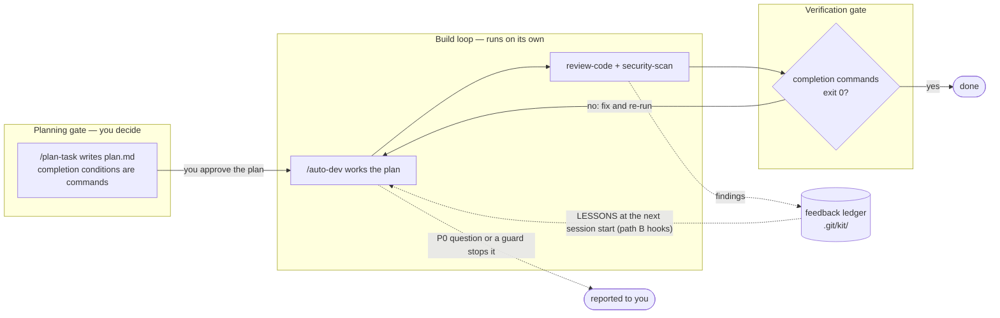
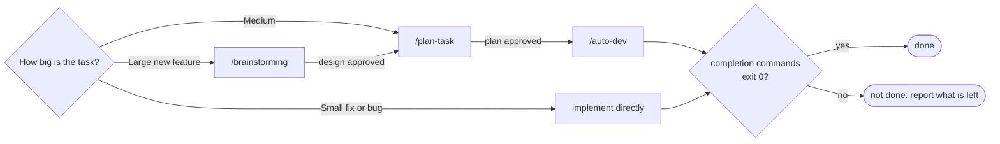
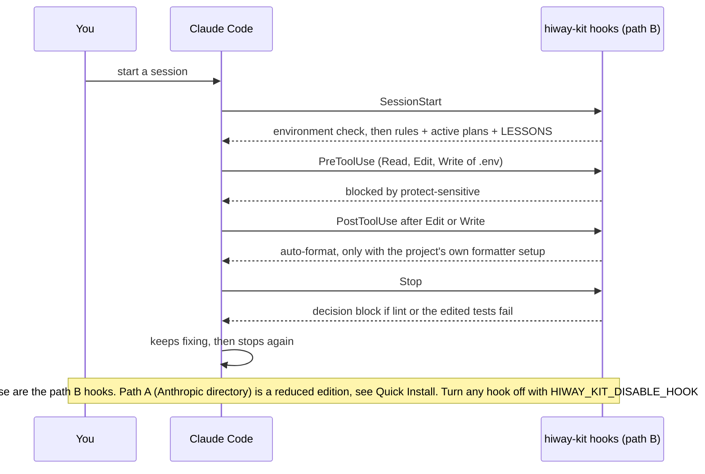

# hiway-kit

> **Done is an exit code, not a claim.**

hiway-kit is a plugin of agents, skills and rules for Claude Code, Codex and Antigravity. Larger work
goes through a plan before any code, and a task counts as finished only when the command that checks
it exits 0.

Ask a coding agent for a feature and it starts typing at once. An hour later it reports that
everything is done. Often a requirement nobody pinned down was guessed, the test it mentions never
ran, or a module boundary the design relied on quietly broke. The agent isn't lying. It has nothing
to check its work against except its own judgment. **hiway-kit gives it something else to check
against:** a plan whose completion conditions are written as commands, and a gate that reads exit
codes instead of sentences.



Claude Code is the full-feature baseline; Codex, Antigravity and Gemini CLI get the partial support
measured in [Where it runs](#where-it-runs). Docs & blog: **[hiway.thishw.com](https://hiway.thishw.com/)**
(English · [한국어](https://hiway.thishw.com/ko/)) · design concepts in Korean:
[docs/concepts.ko.md](docs/concepts.ko.md).

---

## Quick Install

**Prerequisites:** [Claude Code CLI](https://code.claude.com) installed (`claude --version`).
The hooks (install path B) run on your machine's `python3` and need **3.9+** (macOS system Python
qualifies); older interpreters make the hooks no-ops and the session warns you once.

**Install** — pick **one** of the two (installing both loads every skill twice and mixes versions; to switch or clean up, see [Keep one install](docs/harnesses.md#keep-one-install)):

```bash
# A. Anthropic's directory — built into Claude Code, no marketplace to add
/plugin install hiway-kit@anthropic-plugin-directory

# B. This repository as a marketplace — tracks main the moment you update it
/plugin marketplace add This-HW/hiway-kit
/plugin install hiway-kit@hiway-kit
/plugin marketplace update hiway-kit   # later, to pick up a new version
```

Path A is the reviewed listing, and **from 5.9.1 it is a reduced edition**: Anthropic's directory
accepts command hooks, script files and some agent frontmatter keys only from Verified
organizations, and this kit's publisher is not one yet. That edition has the skills and agents; the
rule files ship too, but without hooks nothing loads them. It has no Python tools and no
`code-intel`, `session-history` or `harness-export` (they need those tools), and agents run without
worktree isolation — file-changing agents return their changes without committing and run one at a
time. Pages that call a missing tool or rely on isolation say so at the top. Until a newer version
passes the directory's review, path A serves 5.5.1. For the full kit, use path B. Path B and the
5.5.1 path A were verified on a clean Claude Code config (no claude.ai sign-in) on 2026-10-05. The listing does not yet show up in claude.ai's web directory search; the install
command above works regardless.

### Installing changes the whole machine, not just this project

Plugins install at **user scope**, so installing, updating or removing one changes hook
registration and rule injection for **every session on this machine — including ones running
right now**. A session that started under a previous install keeps its already-injected
context, but its hooks may stop resolving mid-flight.

Do it when no long-running work is in progress, or accept that in-flight sessions should be
restarted afterward. There is also **no plugin aliasing**: two differently-named plugins that
ship the same skills both register, silently, because the dedup key is
`<plugin name>:<skill name>` (measured — `docs/specs/2026-09-07-rename-probe.md`). Never run
two kits that carry the same skills at once.

### Full Mode (+ pre-commit)

`setup.sh` installs the plugin through **path B** (this repository as a marketplace) at user scope,
which records it in your Claude Code user settings, and installs the git pre-commit hook into the
repository you run it from (not under `core.hooksPath`, which git would ignore). It keeps its own
state in `~/.claude/.setup-state.json`. It asks before setting `git init.templateDir` (every repository
you create or clone afterwards gets the hook) and skips that question in a non-interactive run. It
does not install a global ruff config or set `autoMemoryDirectory`.
If you already installed path A, uninstall it first
(`/plugin uninstall hiway-kit@anthropic-plugin-directory`) — otherwise both load.

```bash
git clone https://github.com/This-HW/hiway-kit
cd hiway-kit
./setup.sh
```

Options:

- `./setup.sh --status` — Check setup state
- `./setup.sh --migrate` — Run from your project: moves only the `.claude/agents`·`.claude/skills` entries whose **name collides** with a plugin one into `*.bak/` (your own project-local agents stay put)
- `./setup.sh --force` — Reset and re-run setup
- `./setup.sh --uninstall [--dry-run]` — Revert what setup wrote (unmodified copies only; a template dir holding
  your own files stays set) and print the plugin uninstall commands. Copies the template dir already planted in
  other repos cannot be found — run it in each of those repos

Other harnesses (Codex, Antigravity, Cursor, Gemini CLI, the `skills` CLI): see
[Where it runs](#where-it-runs) and the install details in [docs/harnesses.md](docs/harnesses.md).

---

## Start here

Pick the path by the size of the task. The skills own the details; agents are invoked by those
skills, not chained by hand.



What to type first:

```skills
Starting a large new feature?       → /brainstorming, then /plan-task
A change with several steps?        → /plan-task, then /auto-dev
A bug whose cause isn't obvious?    → /debug
Finished a diff, before merging?    → /review
Tests failing?                      → /test
Need outside sources compared?      → /web-research
A design doc needs pushback?        → /multi-perspective-review
Rules for Codex, Gemini or Cursor?  → /harness-export
Coordinating worker sessions?       → /control-loop
```

Size criteria (Small / Medium / Large) are owned by
[`elicitation.md` §6](plugins/common/skills/plan-task/references/elicitation.md); the plan file
format by [`plan-format.md`](plugins/common/skills/plan-task/references/plan-format.md).

---

## What you get

Every row names the file that does it. Rows marked *(hooks)* need install path B.

| Without the kit | With hiway-kit | Where it lives |
| --- | --- | --- |
| The agent says "done" because it feels done | "Done" means the verification command ran fresh and exited 0; until then the report says what is left | [`rules/definition-of-done.md`](plugins/common/rules/definition-of-done.md) |
| Open questions get guessed silently | Questions are graded P0–P3; only P0 (data integrity, security, money, core business) stops and asks you | [`rules/planning-protocol.md`](plugins/common/rules/planning-protocol.md) |
| Plans disappear into chat history | Medium and Large work gets a plan file whose completion conditions are commands | [`plan-task/references/plan-format.md`](plugins/common/skills/plan-task/references/plan-format.md) |
| The author reviews their own diff | `review-code` reviews it in a separate context, adversarially | [`agents/review-code.md`](plugins/common/agents/review-code.md) |
| The same mistake comes back next week | Review findings go to a capped, de-duplicated ledger under `.git/kit/`; the recurring ones return as lessons at session start *(hooks)* | [`tools/feedback_ledger.py`](plugins/common/tools/feedback_ledger.py) |
| An agent reads or edits `.env` | Sensitive paths are blocked before the tool runs *(hooks)* | [`hooks/protect-sensitive.py`](plugins/common/hooks/protect-sensitive.py) |
| A turn ends with the tests it edited failing | On Stop, lint and the edited tests run; a failure makes the agent continue *(hooks)* | [`hooks/stop-validator.py`](plugins/common/hooks/stop-validator.py) |

The kit assumes no MCP server. Agents never list `mcp__*` tools; skills use the search or docs
servers you have installed and fall back to built-in tools when they are absent
([`rules/mcp-usage.md`](plugins/common/rules/mcp-usage.md)). It neither assumes nor conflicts with
other plugins.

---

## Where it runs

**Claude Code is the full-feature baseline.** The kit's plugin root (`plugins/common/`) also ships
**native plugin manifests** for Codex, Antigravity and Cursor, generated from the same source of truth as
the Claude Code manifest (`packaging/targets.json` + `scripts/build-targets.py` — see
[`packaging/README.md`](packaging/README.md)). What reaches each harness differs by platform
capability. The cells below cite the measurement they rest on; the dated records live in
`packaging/targets.json` and `docs/specs/2026-10-05-audit-remediation/audit/A-harness.md`
(codex 0.159.3, agy 1.2.17, measured 2026-10-05). Install commands for each harness:
[docs/harnesses.md](docs/harnesses.md).

| Component | Codex | Antigravity |
| --- | --- | --- |
| Skills | ✅ `"skills": "./skills/"` — all recognized (measured 2026-10-05) | ✅ recognized by the model (measured 2026-10-05); running a skill end-to-end is unmeasured |
| Rules | ⚠ no dedicated field → hook injection (marketplace install) or `AGENTS.md` (see [`/harness-export`](plugins/common/skills/harness-export/SKILL.md)) | ❌ **plugin `rules/` does not arrive** (a token planted in `rules/` never reached the model, measured 2026-10-05 — although Google's plugin docs list `rules/`). Norms reach Antigravity **only** through the entrypoint file |
| Agents | ⚠ no plugin field — files ship but are not exposed as subagents | ❌ **not recognized** — even after the 5.3.0 flat layout, `agy agents` lists none of them. The cause is the `model: haiku\|sonnet\|opus` frontmatter (an agent with `model: inherit` or no `model` is recognized — bisected 2026-10-05), not the folder layout. `agy plugin validate` counts files only (an empty `junk.txt` counts as an agent), so its green "agents processed" line is not evidence of recognition |
| Hooks | ⚠ `session-start` and `auto-format` ship and require native trust and an enabled state — see [Trusting and enabling Codex hooks](docs/harnesses.md#trusting-and-enabling-codex-hooks). `protect-sensitive` is not shipped (see *Automatic blocking*) | ❌ not shipped — format unverified |
| MCP servers | ❌ not bundled (kit doesn't ship MCP servers) | ❌ not bundled |

**Parity contract**: rules and skills (norms and procedures) work on every harness — but how the
norms arrive differs, and on some paths they arrive only if you export them:

| | Claude Code | Codex | Antigravity |
| --- | --- | --- | --- |
| Rules | hook injection (install path B — path A's edition has no hooks, see Quick Install) | hook injection (marketplace install, after hook trust) — `AGENTS.md` is the fallback | `AGENTS.md` / `GEMINI.md` only — Antigravity reads **both**, so identical copies load twice |
| Ledger digest (memory) | hook injection (path B only) | hook injection; rules also tell the agent to fetch it itself | self-fetch per the rule (unmeasured) |
| Skills | native | recognized | recognized |
| Subagents | ✅ | **not exposed** — skills degrade to in-session execution | not recognized (`model:` frontmatter, see above) |
| Agent `model` / `effort` frontmatter | ✅ applied per agent | ❌ not applied — everything runs on the model/effort in your Codex config | ❌ not applied |
| Automatic blocking | `PreToolUse` veto | **none shipped.** On codex 0.153.4 a `PreToolUse` block did not stop the command; **on codex 0.159.3 it does** (measured in the 2026-10-05 audit, recorded in `packaging/targets.json`). Porting `protect-sensitive` is a separate decision — its payload differs (`Bash`/`apply_patch`) | none |

Put plainly: **what a non-Claude-Code harness loses is dedicated executors (subagents), automatic
blocking, and — on Antigravity, Gemini CLI, and the Codex directory ZIP — automatic injection**
(there you run `/harness-export`). Everything else keeps working, because it depends only on git and
external processes: discipline (rules), procedure (skills), state (child session markers under
`gitdir/kit/child.json`), and the registry `describe` seam. One caveat: behavioral evals (`evals/`)
currently drive only Claude Code — the harness call sits behind one seam (`evals/run.py`'s
`Harness` protocol) but no Codex/Antigravity implementation exists yet.

---

## Components

### What's Included

| Plugin            | Agents | Skills | Description                               |
| ----------------- | ------ | ------ | ----------------------------------------- |
| `hiway-kit` | 15     | 17     | Core: planning, development, review, code intelligence, history |

v5.0.0 cut the kit roughly in half, down to what earns its place: components with a native
equivalent, that no skill ever invoked, or that only worked inside this repository were removed —
see the migration table in [CHANGELOG](CHANGELOG.md).

<details>
<summary><b>Skills and agents</b> — what each one does</summary>

### Key Skills

| Skill                      | Command                     | Description                                                                |
| -------------------------- | --------------------------- | -------------------------------------------------------------------------- |
| `brainstorming`            | `/brainstorming`            | Design and spec for Large new features, before planning                    |
| `plan-task`                | `/plan-task`                | Structured planning into `docs/plans/<date>-<slug>/plan.md`                |
| `auto-dev`                 | `/auto-dev`                 | Run a completed plan through development and validation                    |
| `web-research`             | `/web-research`             | Research with whatever search/docs/browser tools the session has           |
| `review`                   | `/review`                   | Lint + adversarial `review-code` + `security-scan` (also works on Codex)   |
| `multi-perspective-review` | `/multi-perspective-review` | 3-round deliberation across perspectives, consensus-driven                 |
| `debug`                    | `/debug`                    | Diagnose an error, fix it with `fix-bugs`, confirm with `verify-code`      |
| `test`                     | `/test`                     | Run tests and fix failures                                                 |
| `agent-creator`            | `/agent-creator`            | Create a project agent in `.claude/agents/` with valid frontmatter         |
| `control-loop`             | `/control-loop`             | Coordinate worker sessions — investigate, decide, dispatch, verify, merge  |
| `child-session`            | (loaded by workers)         | Discipline a dispatched worker session follows                             |
| `cross-engine-review`      | `/cross-engine-review`      | Evidence-backed consensus between sessions on different engines            |
| `harness-export`           | `/harness-export`           | Export host-neutral rules to `AGENTS.md`/`GEMINI.md` for other harnesses   |
| `skill-forge`              | `/skill-forge`              | Distill a solved hard problem into a reusable skill draft                  |
| `code-intel`               | `/code-intel`               | AST search/preview and LSP queries in trusted workspaces; servers may execute project code |
| `session-history`          | `/session-history`          | Bounded search of explicitly selected Codex/Claude session logs |
| `using-hiway-kit`          | (injected at session start) | Workflow chain and plan file rules                                         |

### Planning Agents (Opus)

Used in Phase 1. They return analysis; the caller writes any files.

| Agent                   | Description                                                                   |
| ----------------------- | ----------------------------------------------------------------------------- |
| `clarify-requirements`  | Detects ambiguous requests, generates P0/P1/P2 questions                      |
| `define-business-logic` | Defines policies, rules, calculations, state transitions (CALC/VAL/STATE/POL) |
| `design-user-journey`   | User flows, screens, onboarding, state transitions                            |

### Meta Agent (Opus)

| Agent             | Description                                                                                         |
| ----------------- | --------------------------------------------------------------------------------------------------- |
| `devils-advocate` | Failure scenario analysis via 4 attack personas (scalability / dependency / maintainability / cost) |

### Dev Agents

| Agent                  | Model  | Description                                                                |
| ---------------------- | ------ | -------------------------------------------------------------------------- |
| `plan-implementation`  | Opus   | Requirements → tech decisions → task breakdown → risk analysis             |
| `implement-code`       | Sonnet | Code implementation (worktree isolated)                                    |
| `write-tests`          | Sonnet | Unit / integration / API / E2E tests (worktree isolated)                   |
| `review-code`          | Opus   | Adversarial review via 4 personas: hacker, murphy, future-self, picky-user |
| `fix-bugs`             | Sonnet | Minimal-change bug fixes (worktree isolated)                               |
| `verify-code`          | Haiku  | Type check, lint, build, test execution                                    |
| `security-scan`        | Sonnet | OWASP Top 10, secret exposure, vulnerable component detection              |
| `git-workflow`         | Haiku  | Branches, merges, rebases; reports conflicts instead of guessing           |
| `sync-docs`            | Haiku  | API and architecture documentation sync (worktree isolated)                |
| `analyze-dependencies` | Haiku  | Dependency versions, impact range, security updates                        |
| `research-external`    | Sonnet | External library / technology / best practice research                     |

</details>

<details>
<summary><b>How it's built</b> — agent tiers, phase gate, model selection, layout</summary>

### 2-Tier Agent Model

```
Tier 1: plugins/common/  — Core agents for all projects
Tier 2: project-local/   — Project-specific agents (user-defined)
```

### Phase Gate Pattern

Larger work follows a 3-phase gate; small fixes don't need the ceremony:

```
Phase 1 (Planning)     → Remove ambiguity (brainstorming only for Large new features)
Phase 2 (Development)  → Implement based on Phase 1 artifacts
Phase 3 (Validation)   → Review + security scan
```

### Model Selection

| Model      | Use Case                   | Examples                                                     |
| ---------- | -------------------------- | ------------------------------------------------------------ |
| **Opus**   | Strategy, analysis, review | `clarify-requirements`, `review-code`, `plan-implementation` |
| **Sonnet** | Code implementation, fixes | `implement-code`, `fix-bugs`, `write-tests`                  |
| **Haiku**  | Quick checks               | `verify-code`, `git-workflow`, `analyze-dependencies`        |

### Worktree Isolation

File-modifying agents run in an isolated git worktree to prevent conflicts:
`implement-code`, `fix-bugs`, `write-tests`, `sync-docs`.

Merge-back rules (verify-then-exit, sequential merge, conflict escalation to
`git-workflow`) live in `rules/parallel-worktree.md`.

### Delegation Signal — removed in v2.16.0

Agents used to end every response with a structured `---DELEGATION_SIGNAL---` block so that
main Claude could read `TYPE`/`TARGET` and auto-invoke the next agent. **That contract is gone.**
Nothing parsed it, and sequencing already came from the invoking skill. Full rationale:
[`docs/architecture/delegation-signal-retirement.md`](docs/architecture/delegation-signal-retirement.md).

### Project Structure

```
plugins/
└── common/      — Core agents + skills + rules + hooks
```

The plugin contains:

- `.claude-plugin/plugin.json` — plugin manifest (no agent/skill registry — both are auto-discovered)
- `agents/` — agent `.md` files with YAML frontmatter (flat, no subfolders)
- `skills/<name>/SKILL.md` — skills, each with optional `references/`
- `hooks/` — Python session hooks
- `tools/` — Python tools the skills call (kept out of `hooks/` because the OpenAI directory rejects `hooks/`)
- `rules/` — governance rules injected by tier
- `setup/` — git hooks (`pre-commit`, opt-in `git-hooks/`) and the setup-time session check
- `.codex-plugin/plugin.json`, `plugin.json` — generated Codex/Antigravity manifests (don't hand-edit)

The design philosophy (native-first, the four strands the kit fuses, harness × loop engineering) is
written up in Korean in [docs/concepts.ko.md](docs/concepts.ko.md). Contributor details
(frontmatter, adding an agent or skill, release) are in [CLAUDE.md](CLAUDE.md).

</details>

---

## Security

The only official install sources are Anthropic's plugin directory and this repository
(`github.com/This-HW/hiway-kit`); every other install path in this README pulls from this repository.
Report vulnerabilities privately — see [SECURITY.md](SECURITY.md).

What the hooks do in a Claude Code session (install path B):



- **Hooks:** `protect-sensitive.py` runs on Edit/Write/MultiEdit/NotebookEdit/Read/Grep and blocks
  sensitive file **paths**: `.env`, key and certificate files, SSH/cloud credential directories,
  `secrets/` directories, and *data or config* files named after credentials, secrets, tokens or
  passwords (`credentials.json`, `client_secret.json`, `api_token.yaml`), including modules named
  just that (`secrets.py`, `config.secret.ts`). Source, SQL and docs that only use such a word in a <!-- doc-ref-ok: 외부 사용자 레포의 예시 파일명 -->
  compound name (`credential_collector.py`, `sp_rotate_secret.sql`) are not blocked, and nothing <!-- doc-ref-ok: 외부 사용자 레포의 예시 경로 -->
  else in the kit guards what they contain.
  It matches paths only — it does not inspect `Bash` commands or scan commits; secret scanning of
  this repository is gitleaks in CI (every commit in each push/PR range) and
  `scripts/verify-done.sh` §24 locally. A path field that is not a string (a list, an object), or
  input it cannot parse for a watched tool, is blocked rather than let through. Grep is blocked when
  its `path` is a sensitive file; when it searches a credential-store directory (`~/.ssh`, `~/.aws`,
  `secrets/`, `credentials/`) or a directory that holds one of your home's stores, such as your home
  or `/` (Claude Code's Grep searches hidden files); and when its `glob` names or can select a
  protected file — ripgrep's `--glob` overrides `.gitignore`, so `*`, `**`, `*env` or `config/*` read
  an ignored `.env`. A glob the hook cannot parse the way ripgrep does (escapes, nested braces,
  reversed ranges, very long lists) is blocked too. Drop the glob, use `path` for a directory, or
  narrow it to a file type (`*.py`). Out of its reach by design: access through `Bash`, a hardlinked copy under another name,
  the contents of files outside the protected names, Grep over other directories, globs that narrow
  to data files (`*.json` or `cr*` can still select an ignored `credentials.json`), and Glob (it
  returns names only). Codex does not register this hook.
- **Hidden characters:** text the hooks inject from your repository (plan titles, LESSONS) has
  zero-width, bidi-control and tag characters removed and marked `[hidden-chars-removed:N]`. This
  repository's own tracked text is gated to contain none (`scripts/check_unicode_safety.py`).
- **Auto-format / stop-time checks (Python):** `auto-format.py` and `stop-validator.py` run ruff
  **only in projects that configure it** (`ruff.toml`, `.ruff.toml`, or `[tool.ruff]` in
  `pyproject.toml`), and leave files that config excludes alone; prettier/eslint run only when
  the project has their config **and** has them installed in its `node_modules`; gofmt only inside a
  Go module (`go.mod`), rustfmt only with a `rustfmt.toml`/`.rustfmt.toml`.
  `stop-validator.py` also runs the test files you edited. Nothing checks SQL.
- **Turning a hook off:** set `HIWAY_KIT_DISABLE_HOOKS` (comma-separated names, or `all`) in your
  project's `.claude/settings.json` (team) or `.claude/settings.local.json` (just you) — do not edit
  the cached `hooks.json`, an update restores it:

  ```json
  { "env": { "HIWAY_KIT_DISABLE_HOOKS": "stop-validator,auto-format" } }
  ```

  Names: `session-start`, `session-check`, `protect-sensitive`, `auto-format`, `stop-validator`.
  A committed `.claude/settings.json` turns them off for everyone who opens the repository. On
  Codex, which does not read these files, the variable has to be in the environment Codex starts
  with (not verified).
- **Policy:** Never hardcode API keys, secrets, or internal IPs

### Keep your private project names out of commits

Pattern-based scanners can't catch an arbitrary private name — you'd have to write the name
into a committed config, and that file then *is* the leak. So the list lives in a
**gitignored local file** and the pre-commit hook reads it:

```bash
printf 'my-internal-project\nacme-codename\n' > .private-names   # already in .gitignore
```

Any staged file containing one of those strings blocks the commit — **provided the hook
installed in your repo is the one carrying this check**. With no `.private-names` the check
is skipped and says so — it never reports protection it isn't providing.

> **Check before you rely on it**: `grep -c private-names "$(git rev-parse --git-path hooks)/pre-commit"`.
> A `0` means your installed hook predates this feature and the guard is **not** active.
> Nothing installs this hook for you at session start — since v5.0.0 the plugin never writes into
> your `.git/hooks/` (earlier versions silently installed it in plugin-only mode). Install it
> explicitly with `./setup.sh`, or copy `plugins/common/setup/pre-commit` over your hook (that
> overwrites local edits to it, so diff first if you customized it).

This exists because it actually happened: on 2026-09-08 a private project name reached three
design documents and the repo's gitleaks rule caught **none** of them (its regex only matched
a `_suffix` form). Measured precision of that rule across full history: 4%.

## Data handling

The plugin has no telemetry or publisher service. Local helpers read selected project files
and session logs; the publisher receives no data from these helpers.
The full policy is in [PRIVACY.md](PRIVACY.md).

- **Local processes are not sandboxed by the kit.** Hooks and tools invoke installed commands,
  including language servers, AST search, formatters, tests and verification commands. A language
  server can execute project build scripts or macros, write caches or access the network.
  Use code intelligence only in workspaces you trust. Its read-only queries and replacement
  previews do not guarantee that the server or project configuration has no side effects.
- **C/C++ navigation writes a per-user clangd index cache.** It uses
  `XDG_CACHE_HOME/hiway-kit/code-intel/clangd`, or `HOME/.cache/hiway-kit/code-intel/clangd` when
  `XDG_CACHE_HOME` is unset. The cache retains up to 16 keys with 128 MiB per key and a 512 MiB
  aggregate cleanup target (excluding temporary files); temporary preambles use a separate 512 MiB sampled target and are
  cleared after each query. These are sampled cleanup targets, not hard filesystem quotas. LRU
  cleanup skips active entries. To clear the cache manually, first ensure no code-intel LSP query
  is running, then remove that `clangd` cache directory. Set `HIWAY_CODE_INTEL_INDEX=0` to disable
  automatic C/C++ background indexing. Indexing uses one-shot processes, not a persistent daemon;
  a new key can use up to 30 seconds and an existing key up to 5 seconds. Large projects may return
  partial results across several calls. Cache files remain local and are not sent to the publisher.
- **No telemetry or plugin accounts.** Selected session logs and project files can contain personal
  or sensitive information. Their contents are returned locally to the calling agent; that agent's
  provider and any external tools remain subject to their own data policies.
- **What it writes stays on your machine.** The feedback ledger (recurring review findings) is
  kept under your repository's `.git/kit/` (untracked; outside a git repo nothing is recorded);
  hook state and locks live in a per-user `0700` directory under your system temp dir. Delete
  them at any time. The kit creates nothing in your working tree on its own: plan and spec files
  go where you or your project's instructions say, and a missing `docs/plans/` or `docs/specs/`
  folder is created only after asking; whether to commit them is your project's call. Agents
  follow your existing layout (tests, docs), never install dependencies, and change CLAUDE.md or
  AGENTS.md only when you ask — see [the consumer footprint policy](docs/conventions/consumer-footprint.md).
- **Web access is your agent's, not the plugin's.** Skills such as `web-research` tell the agent
  to use search/browser tools *you* have installed; the plugin itself ships no connector.

---

## Contributing

**Who this is for (design north-star):** a plugin installed into *your* projects — not a tool for this repo alone. Every change is judged by whether it works in a consumer's environment: plugin files live in the plugin cache (not your project cwd), MCP servers may be absent or different, and hooks run on every session. A change that only works in this repo is a defect.

Install problem or quick feedback: open an [issue](https://github.com/This-HW/hiway-kit/issues/new/choose)
— the templates ask only for what helps reproduce it, and nothing is uploaded automatically. Security
issues go to a private advisory instead ([SECURITY.md](SECURITY.md)).

PRs welcome. Checklist:

- [ ] **Consumer-first**: works in an installing user's environment (plugin files in the cache, not project cwd; no assumed MCP server; hooks fail-open) — not just this repo
- [ ] No `mcp__*` tools in any agent `tools:` allowlist (MCP lives in skills; absent MCP in an agent allowlist hallucinates, CC #13898)
- [ ] Agent frontmatter has `name`, `description`, `model`, `maxTurns`
- [ ] Description includes `MUST USE when:` trigger conditions
- [ ] No forbidden fields: `permissionMode`, `context_cache`, `output_schema`, `next_agents`, inline `hooks`
- [ ] File-modifying agents have `isolation: worktree`
- [ ] Regular agents have `disallowedTools: [Task]`
- [ ] Skill `description` field is in English
- [ ] Plugin metadata in `plugin.json` is filled (`homepage`, `repository`, `license`, `author.email`) — components are **not** registered there; agents and skills are auto-discovered from their directories
- [ ] Version bumped with `scripts/bump-version.sh` + matching `CHANGELOG.md` entry ([release process](docs/conventions/release-process.md))
- [ ] `scripts/verify-done.sh` green locally and CI green

### Collaboration across harnesses

Shared isolation, integration and cleanup responsibilities are separated from runtime-specific
execution in the [control-loop transport guide](docs/control-loop-transport.md). It covers external
orchestration, native subagents, large parallel workflows and single-session execution.
The [repository collaboration choice](docs/conventions/coordination.md) applies to this repository,
not to projects that install the kit.

---

## License

MIT
